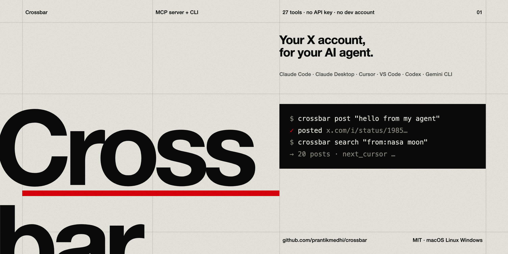

<div align="center">



# Crossbar

**Give your AI agent your X (Twitter) account. No API key, no developer account, no API bill.**

[](https://github.com/prantikmedhi/crossbar/stargazers)
[](LICENSE)
[](https://nodejs.org)
[](#-27-mcp-tools)
[](#claude-code-plugin-skills--agents-included)
[](#-install)

[Install](#-install) · [What you can ask](#-what-you-can-ask) · [Skills & agents](#-skills--agents) · [Tools](#-27-mcp-tools) · [CLI](#-cli) · [How it works](#-how-it-works)

</div>

---

Crossbar turns **your own X account** into an MCP server and a CLI. Claude Code, Claude Desktop,
Cursor, VS Code, Codex and Gemini CLI get 27 tools to read your timeline, search, read threads,
check mentions and DMs, and post, reply, quote, like, repost, bookmark, follow, mute, block and DM,
all as you.

It sends the same requests x.com's web app sends, with the session from the browser you're
already signed in to, from your own machine. Built on
[api-anything](https://github.com/goodnight000/api-anything).

```text
you>    what's new from people I follow? reply to the best one with "great thread"
claude> [x_home_timeline feed=following] ... [x_reply post=1985... text="great thread"]
        ✓ replied  https://x.com/i/status/1985...
```

## Why Crossbar

| | Official X API | Crossbar |
|---|---|---|
| Developer account + app review | required | **not needed** |
| API keys / OAuth app | required | **not needed**: uses your browser session |
| Monthly bill | paid tiers for real read access | **free** |
| Read timeline, search, threads, DMs | tier-gated | ✅ |
| Post, reply, like, follow, DM | ✅ | ✅ |
| Works in Claude / Cursor / Codex / Gemini | build it yourself | ✅ one command |
| Survives X changing its endpoints | n/a | ✅ self-heals |

## ⚡ Install

Needs **Node 22.13+** and a Chromium browser (Chrome, Edge, Brave, Arc, Vivaldi or Chromium)
signed in to x.com.

**One line, any OS:**

```bash
npm install -g github:prantikmedhi/crossbar && crossbar setup && crossbar login
```

That installs the `crossbar` command, connects the MCP server to every agent it finds on your
machine, and imports your x.com session from your browser. Restart your agent and ask
*"what's on my X timeline?"*

### Claude Code plugin (skills + agents included)

```text
/plugin marketplace add prantikmedhi/crossbar
/plugin install crossbar@crossbar
```

The plugin brings the MCP server (run through `npx`, nothing else to install), three skills and
three subagents. Run `npx -y github:prantikmedhi/crossbar login` once to sign in.

<details>
<summary><b>Other ways to install</b></summary>

**From a clone, macOS / Linux**

```bash
git clone https://github.com/prantikmedhi/crossbar && cd crossbar && ./install.sh
```

**From a clone, Windows (PowerShell)**

```powershell
git clone https://github.com/prantikmedhi/crossbar; cd crossbar; powershell -ExecutionPolicy Bypass -File .\install.ps1
```

**Without installing anything globally**: point any MCP client at:

```json
{ "mcpServers": { "crossbar": { "command": "npx", "args": ["-y", "github:prantikmedhi/crossbar", "mcp"] } } }
```

**Read-only agent** (no write tools at all):

```bash
crossbar setup --read-only
```

**Print the config** for any client, to add it by hand:

```bash
crossbar mcp --print-config
```

</details>

`crossbar setup` puts the X spec in `~/.api-anything/sites/x.json` and connects the MCP server
with `claude mcp add`, `codex mcp add`, `gemini mcp add` and `code --add-mcp`, and edits Claude
Desktop's and Cursor's JSON configs. It backs up each config to `*.bak-crossbar` before the first
edit. `--dry-run` shows what it would change.

## 💬 What you can ask

Once it's connected, just talk to your agent:

- *"Summarize my Following timeline from today. Skip the memes."*
- *"What are people on X saying about Claude Code plugins this week? Give me the best 5 takes with links."*
- *"Check my mentions and DMs. What needs a reply?"*
- *"Read this thread and draft a reply that pushes back on point 3: https://x.com/..."*
- *"Turn this changelog into a post in my voice. Show me three options first."*
- *"Who are the most active accounts replying to @anthropicai about MCP?"*
- *"Bookmark the top post on `from:nasa moon` and like it."*

Writes are marked as writes (⚠ for destructive ones) in MCP, so your client asks before it posts.

## 🧠 Skills & agents

Crossbar ships ready-made know-how for agents, in [`skills/`](skills) and [`agents/`](agents).
The Claude Code plugin installs them for you. For other agents that read
[Agent Skills](https://agentskills.io), copy the `skills/` folders into that agent's skills directory.

| Skill | What it does |
|---|---|
| [`crossbar`](skills/crossbar/SKILL.md) | The operating manual: sign-in, paging, search operators, safe writes, pace |
| [`x-research`](skills/x-research/SKILL.md) | Turns "what's X saying about…" into a sourced brief with links for every claim |
| [`x-write-like-me`](skills/x-write-like-me/SKILL.md) | Learns your voice from your own posts, drafts options, posts only what you approve |

| Subagent | What it does |
|---|---|
| [`x-researcher`](agents/x-researcher.md) | Read-only research on a topic, person or launch. Never writes. |
| [`x-inbox-triage`](agents/x-inbox-triage.md) | Mentions + notifications + DMs → ranked "needs you" digest with suggested replies |
| [`x-engager`](agents/x-engager.md) | Drafts replies, quotes and threads, sends each only after your explicit yes |

## 🔑 Sign in and out

| | |
|---|---|
| `crossbar login` | imports your x.com session from your everyday browser: no password, no 2FA again. Sign in to x.com there first. |
| `crossbar login --profile "Chrome/Profile 1"` | picks the browser profile when several are signed in |
| `crossbar login --window` | opens a browser window to sign in by hand (2FA, captchas) |
| `crossbar login --cookies cookies.txt` | imports a cookies.txt or Cookie-Editor JSON export (headless servers) |
| `crossbar logout` | forgets Crossbar's copy of the session. Your browser stays signed in. |
| `crossbar whoami` | shows the account you're signed in as |

The session stays in `~/.api-anything/` on your machine (0600) and never leaves it. It's the
**same** session as your browser's: signing out of X in the browser signs Crossbar out too. Then
run `crossbar login` again.

## 🧰 27 MCP tools

| Read | Write (acts as you) |
|---|---|
| `x_whoami` | `x_post` |
| `x_home_timeline` (for_you / following) | `x_reply` |
| `x_search` (latest / top / media / people, X's operators) | `x_quote` |
| `x_get_post` (post + thread + replies) | `x_delete_post` ⚠ |
| `x_user_profile` | `x_like` (`undo` unlikes) |
| `x_user_posts` (`include_replies`) | `x_repost` (`undo`) |
| `x_likes`, `x_bookmarks` | `x_bookmark` (`undo`) |
| `x_followers`, `x_following` | `x_follow` (`undo` unfollows) |
| `x_notifications`, `x_mentions` | `x_mute`, `x_block` ⚠ (`undo`) |
| `x_dm_inbox`, `x_dm_conversation` | `x_send_dm` (to `@user` or a conversation) |
| `x_login`, `x_logout` | |

Posts accept an id or a URL. Users accept `@handle`, a profile URL or a numeric id. Lists are
paged: pass `next_cursor` back as `cursor`.

## ⌨️ CLI

The same account, from your terminal:

```bash
crossbar home --following
crossbar search "from:nasa moon" --mode latest
crossbar read https://x.com/jack/status/20
crossbar profile @nasa
crossbar posts @nasa --replies
crossbar post "Hello from Crossbar"
crossbar reply 1985000000000000000 "Agreed"
crossbar like <post> --undo
crossbar follow @nasa
crossbar dm @friend "hey"
crossbar dms
crossbar notifications
```

Run `crossbar --help` for every command. Add `--json` for the raw answer, which is handy for
scripts and `jq`.

## 🔧 How it works

Crossbar's `spec/x.json` describes 36 X operations in api-anything's format: X's GraphQL and
v1.1 endpoints, with `cookie:ct0` → `x-csrf-token` and your cookies filled in per call. The spec
holds no credentials. Each call goes through api-anything's tier ladder:

1. **Plain HTTPS** from Node (fast, about 0.2–1 s).
2. If X blocks that: `fetch` from inside a real browser page.
3. If X needs its own per-request signature (`x-client-transaction-id`): Crossbar runs the action
   in x.com itself in your browser profile. For a post, it opens the composer, types your text and
   clicks Post. Slower, but it works whatever X requires.

### When X changes things

When X rotates a GraphQL `queryId` (it does every few weeks), the first call gets a 404.
api-anything finds the new id in x.com's scripts, replays the call and saves the fix, without a
browser. When X changes the `features` it requires, api-anything re-learns the request from x.com
in your browser. `crossbar status` shows each operation's health. If a heal goes wrong:

```bash
npx api-anything revert x <op>
```

```bash
crossbar install --force
```

The first undoes the last heal of one operation. The second puts Crossbar's spec back.

The `queryId`s and features in the spec were the last ones known to work. They were written by hand
and haven't all been run against live x.com yet, so expect the first calls of some ops to heal
themselves. If one keeps failing, re-learn it from your signed-in browser with api-anything's
learner, e.g. for posting:

```bash
npx api-anything add x createPost --write --trigger https://x.com/compose/post --example text="test one" --example2 text="test two" --steps '[{"action":"fill","selector":"[data-testid=\"tweetTextarea_0\"]","value":"{text}"},{"action":"click","selector":"[data-testid=\"tweetButton\"]"}]'
```

`--write` stops the request in the browser, so learning never posts anything.

## 🗺️ Roadmap

- [ ] Images and video in posts (X's chunked media upload)
- [ ] Polls, scheduled posts
- [ ] Editing and pinning posts, lists, communities, profile editing
- [ ] Starting a DM with someone who has no conversation with you yet
- [ ] Spaces

PRs welcome. Most of these are one new operation in [`scripts/build-spec.mjs`](scripts/build-spec.mjs)
and one tool in [`src/mcp.mjs`](src/mcp.mjs).

## 🤝 Be a good citizen

This is your own account, driven at human pace. api-anything waits about 1 s between calls to a
site and backs off on rate limits. X's terms restrict automation: don't use Crossbar for spam,
bulk following, or anything you wouldn't do by hand. Your account is your responsibility.

## 🛠️ Develop

```bash
npm test
```

`npm test` runs 50 offline tests against api-anything (no network). After editing the spec
generator, run `npm run build:spec`. Check the plugin with `claude plugin validate .`.

## ⭐ Star history

If Crossbar saved you an X API bill, a star helps others find it.

<a href="https://star-history.com/#prantikmedhi/crossbar&Date">
  
</a>

---

<div align="center">

MIT licensed · Made by [Prantik Medhi](https://github.com/prantikmedhi) · Built on [api-anything](https://github.com/goodnight000/api-anything)

</div>
